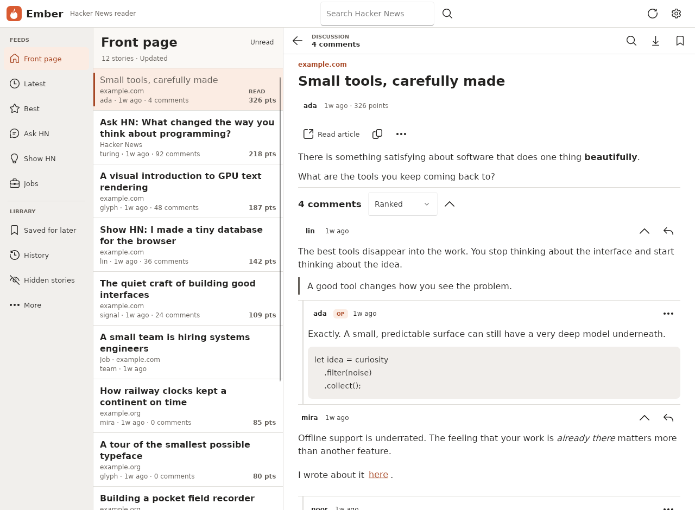

# Ember

Ember is an adaptive, offline-capable Hacker News reader built with
[FerroUI](https://github.com/wieslawsoltes/FerroUI), a Rust UI framework, in its WinUI 3 theme: compiled
XAML, the retained control tree and composition animations. It runs on the desktop, Android, iOS and in
the browser (WebAssembly), all hosts sharing the same application; in the browser it renders into a
canvas, with offline reading through IndexedDB and an installable application shell.

**Open it in the browser:** https://ferroui.github.io/Ember/



The full description of the reader, its architecture, privacy and security properties, and its
verification is in [docs/ember.md](docs/ember.md).

## Repository layout

| Path | Content |
|---|---|
| `Ember.Core/` | models, query construction, repository, cache policy, local state, thread traversal, native SQLite and HTTP adapters |
| `Ember.Content/` | HTML parsing into a safe document model, and its native FerroUI rendering |
| `Ember/` | the shared application: compiled XAML shell, story cards, virtualized thread view, profiles, settings, search, themes |
| `Ember.Desktop/` | the desktop entry point |
| `Ember.Browser/` | the WebAssembly host: Fetch and IndexedDB adapters, URL history, offline shell, host page in `wwwroot/` |
| `Ember.Android/`, `Ember.iOS/` | the mobile hosts |
| `FerroUI/` | FerroUI as a git submodule; the reader builds against its crates |
| `scripts/build-browser.sh` | builds the browser site with FerroUI's script and adds the offline shell |

The repository follows the layout of FerroUI applications described in
[FerroUI/docs/apps.md](https://github.com/wieslawsoltes/FerroUI/blob/main/docs/apps.md): the workspace
dependencies and profiles of `Cargo.toml` are kept in step with the submodule by
`FerroUI/scripts/apps/sync-workspace.py`, and the CI is FerroUI's shared application workflow.

## Run

```sh
git clone --recurse-submodules https://github.com/FerroUI/Ember.git
cd Ember
cargo run --profile fast-release -p ember-desktop
```

Rust 1.89 or newer is required, with the platform prerequisites of FerroUI.

### Browser

```sh
FerroUI/scripts/browser/setup.sh ~/browser-tools
source ~/browser-tools/env.sh
scripts/build-browser.sh
python3 -m http.server 8080 --directory target/browser/ember-browser
```

See [Ember.Browser/README.md](Ember.Browser/README.md) for the browser host, its storage and its offline
behavior.

### Android and iOS

```sh
# Android (the SDK and NDK of FerroUI/scripts/android/env.sh; ANDROID_HOME set)
FERROUI_ANDROID_WORKSPACE=$PWD FerroUI/scripts/android/apk.sh package --package ember-android \
    --label Ember --application-id org.ferroui.ember --permission android.permission.INTERNET
# iOS simulator (macOS with Xcode)
FERROUI_IOS_WORKSPACE=$PWD FerroUI/scripts/ios/bundle.sh --package ember-ios --bin ember-ios \
    --name Ember --bundle-id org.ferroui.ember
```

The Android package installs on a device or emulator with `adb install`; the bundle on the simulator with
`xcrun simctl install booted target/ios-bundles/ember-ios.app`.

## Test

```sh
cargo test --locked -p ember-core
cargo test --locked -p ember-content --no-default-features
cargo test --locked -p ember -p ember-content --features ember-content/render-tests --lib
cargo check --locked -p ember-desktop
npm ci --prefix Ember.Browser && npm test --prefix Ember.Browser
```

## License

MIT, see [LICENSE](LICENSE). Third-party notices are in [NOTICE.md](NOTICE.md).
