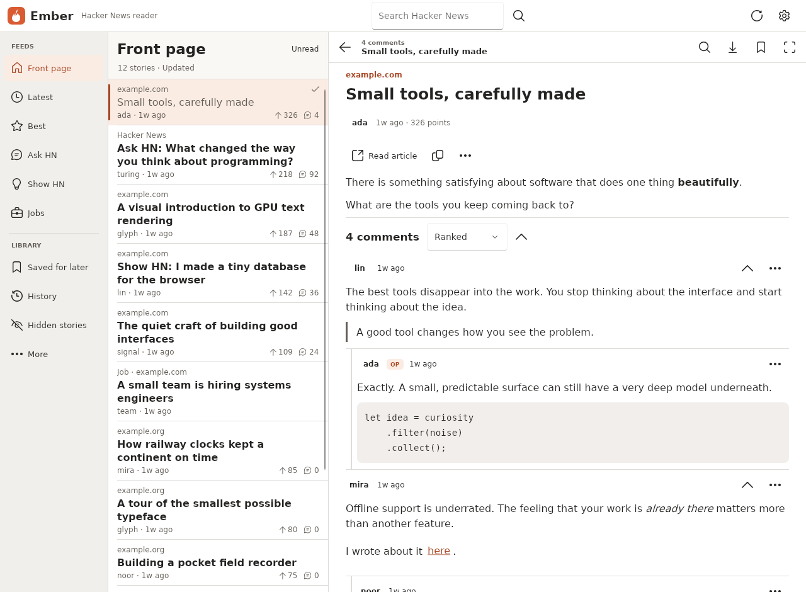

# Ember — Hacker News for FerroUI

Ember is a responsive Hacker News reader built with FerroUI's retained control
tree, compiled XAML, WinUI 3 controls and composition animations. Desktop, browser,
Android and iOS hosts share the same Rust application. The browser runs the
FerroUI application in WebAssembly and renders it into a canvas; its HTML shell
contains only startup and error presentation.

The design combines an amber accent, generous reading surfaces, Fluent icons and
an adaptive navigation rail. Wide windows show navigation, stories and discussion
together. A compact window presents one pane at a time with bottom navigation.

## Rendered screens

All previews use deterministic Hacker News data. Chromium captured the release WebAssembly reading and swipe interactions, discussion search, code tools, Downloads, and storage and mute controls. The native test host rendered the other views with Skia and HarfBuzz.



| View | Previews |
| --- | --- |
| Reading | [Reading desk](images/ember-tablet-reading-desk.png) · [Dark desktop](images/ember-desktop-dark.png) · [Phone feed](images/ember-phone-dark.png) · [Compact feed](images/ember-compact-feed.png) · [Swipe preview](images/ember-swipe-preview.png) · [Landscape reader](images/ember-landscape-reader.png) · [Custom tablet theme](images/ember-tablet-custom.png) |
| Discussions | [Phone discussion](images/ember-phone-comments.png) · [Focus reading with Find](images/ember-focus-find.png) · [New replies](images/ember-new-replies.png) · [Code tools](images/ember-code-tools.png) · [Search this discussion](images/ember-discussion-search.png) |
| Discovery and library | [Open a permalink](images/ember-open-link.png) · [Author profile](images/ember-desktop-profile.png) · [Explore on a phone](images/ember-phone-explore.png) · [Downloaded shelf](images/ember-phone-downloaded.png) · [Find in a collection](images/ember-library-find.png) |
| Preferences | [Custom appearance](images/ember-tablet-settings.png) · [Text presets](images/ember-text-presets.png) · [Domain mute on a phone](images/ember-domain-mute.png) · [Discard mute edits](images/ember-mute-drafts.png) · [Offline storage](images/ember-offline-storage.png) |

The focus view keeps the discussion in a centered column as the window grows. The toolbar retains the story title while you read replies.

## Reading and discovery

| Area | Implemented behavior |
| --- | --- |
| Feeds | Browse the front page, Latest, Best, Ask HN, Show HN and Jobs. The **Unread** count covers the loaded pages and respects mute and visibility settings. With the filter enabled, **Find more unread** checks up to three more pages and stops at the first that adds a visible unread item. Turn the filter off to see the loaded stories again. In split view, the reading desk suggests an unread story from the current list, or the last opened item in History. |
| Explore | Open **More** to browse feeds and see counts for downloaded discussions, reading history and hidden stories. Reader tools include Settings and a keyboard shortcut reference. |
| Search | Search stories, comments, Ask HN, Show HN and polls by relevance or date. Filter by author, discussion, points, comments or a UTC date range. **Search this discussion** in a story or poll menu searches indexed comments beyond the loaded thread. Search results open the exact comment. Under **More filters**, the Discussion field accepts an HN item ID or permalink. Paste a Hacker News item or profile URL into either search field to open it directly. **Edit search** reopens the query from the results header. In **Recent searches**, edit, run or remove one of the last 20 terms. Replaying a term keeps the active filters. |
| Discussion | Browse ranked, newest or oldest branches. Collapsed branches show their reply count. A comment’s menu copies its permalink or jumps to its parent, neighboring top-level comments and the story. Find highlights matching text and keeps its ancestors visible for context. |
| Long threads and polls | The footer counts loaded comments, pending items and unavailable items. Load the next batch or retry missing items directly. Polls retain HN option order and show vote shares once all counts are available and at least one vote has been cast. |
| Profiles | Read the biography and preview up to five recent submissions in HN order. Open an item directly or choose **All stories** or **All comments** to search by that author. **Mute in feeds** hides that author from feeds and search results until you turn it off, here or in Settings. **Copy profile link** copies the HN profile URL. If lookup fails, **Edit username** selects the name for correction. |
| Local library | Browse saved stories, reading history and hidden stories. Use **Find in this collection** to search the selected list on this device. In Settings, choose **Domains**, **Authors** or **Title keywords** to edit mute rules. Switching rule types keeps the draft. **Save filters** applies all three. **Discard filter edits** restores all three to their last saved values. Paste an article URL to mute its domain and subdomains, or enter an author with an optional leading @. |
| Offline reading | Download a discussion to keep its comments on this device. In Saved, select **Downloaded** to open the device’s verified offline discussions. Removing a bookmark leaves its download available. Select the checked download icon to verify or release that copy. |
| Sharing and accounts | Copy the discussion link or open HN to sign in, vote, reply or submit. A comment permalink opens that comment and provides access to its parent. A poll option permalink links back to its poll. |
| Appearance | Choose system, light, dark or custom appearance. Pick a named accent or preview a hex color and custom background. **Text presets** previews four combinations of type size and line spacing. Fine-tune either value, or use **Reset theme & type** to preview the default colors, type size and spacing. Choose **Apply preferences** to save. |
| Data controls | Export or restore local reading state as versioned JSON. Review a backup replacement or clear operation before committing it. |

On a return visit, **New replies** compares the loaded discussion with the copy from your previous visit. A reply that loads for the first time can appear here even if it was posted earlier. The view keeps its earlier parent comments for context, including replies inside folded branches. Switch the filter off to return to your reading position and original folds. Find searches all loaded comments in either view.

The [official Hacker News API](https://github.com/HackerNews/API) exposes public
read operations. Ember's **Vote on HN**, **Reply on HN**, sign-in and submit actions
open the appropriate HN page in the platform browser. They do not report a vote or
submission as completed. Local saved stories are a device library and do not sync
with an HN account. Full-text search uses the separate
[Algolia HN Search API](https://hn.algolia.com/api).

## Navigation, touch and keyboard

Ember uses the available width and height in logical pixels. A short landscape
window uses a single reading pane before the regular width breakpoints apply.

| Available space | Layout |
| --- | --- |
| 600–959 wide and at most 500 high | The five primary tabs move to a 64-pixel strip on the left. The feed or discussion uses the rest of the window. |
| Below 760 wide at other heights | One visible pane with bottom tabs. More opens the remaining feeds and settings. |
| 760–1119 wide at other heights | A 60-pixel icon rail, a 290-pixel story pane and the remaining width for detail. |
| 1120 wide and above | A 172-pixel labeled rail, a 350-pixel story pane and the remaining width for detail. |

The labeled rail layout offers search in the header. The compact rail uses a
search icon, and the single-pane layouts have a Search tab. In a phone
discussion, the pinned **Discussion options** menu provides focus reading,
refresh and link copying. Below 380 pixels it also holds the download action so
more of the headline stays visible. Primary buttons and navigation targets keep
a 44-pixel touch area. Action rows wrap and deep comments limit their indentation.

| Input | Action |
| --- | --- |
| `Ctrl+K` / `Command+K` | Open search. |
| `Enter` in a search field | Open a pasted Hacker News permalink or run the query with its filters. The username field also accepts @names and profile links. |
| `Ctrl+F` / `Command+F` in a library feed | Find in Saved, Downloaded, History or Hidden. Press `Escape` to close Find and return to the list. |
| `Ctrl+F` / `Command+F` in a discussion | Open and focus Find. |
| `Enter` / `Shift+Enter` in discussion Find | Jump to the next or previous matching comment. The count excludes ancestors shown for context. |
| `F` in a discussion | Enter or exit focus reading. On a phone, choose **Focus reading** from **Discussion options**. |
| `Escape` or the reader’s Back button | Close Find, then exit focus reading, then navigate back. Closing Find restores the unfiltered reading position. |
| `J` / `K` | Open the next or previous visible story. With **Unread** enabled, navigation continues from the story you just read even after its row disappears. |
| `U` in a feed or search results | Toggle the unread filter. |
| `R` | Refresh the active feed or discussion. |
| `S` | Toggle the selected story's saved state. |
| `O` | Open the selected story's article, or its HN page when no article is available. |
| Swipe a story left | Reveal **Save** or **Unsave**. Release after the checkmark appears to apply it. |
| Swipe a story right | Reveal **Hide** or **Restore**. Drag back before releasing to cancel. |
| Pull the feed heading down | Refresh after a 72-pixel touch/pen drag. |

Open a story’s context menu by right-clicking, pressing the keyboard menu key, or holding the row on a touch screen. From there you can save, hide, mark read or unread, or copy its HN link. **Undo** in the status bar restores the latest story edit, including a removed bookmark’s original position in Saved. Marking a story unread keeps its visit in History.

Compact story rows combine the source, author and age beneath the headline. Points, replies and reading-state icons remain visible.

Unmodified letter shortcuts are scoped to the feed and discussion. Every swipe action also has a menu command. Browser story navigation updates the URL without reloading the
application, and Back/Forward routes through the reader. A browser URL with
`?item=8863` opens that discussion. The desktop host accepts an initial HN URL as
its first argument.

Search and reader settings mark invalid fields and announce the first error when
you submit. Ember opens the relevant filter or settings section, scrolls its
editor into view, and moves keyboard focus there. Your entries are preserved
while you correct them. Accent presets have accessible names, a selected state,
and a check mark.

Page changes combine a 180 ms composition opacity animation with a 220 ms,
12-pixel vertical entrance. Reduced motion skips both animations. Themes use
dynamic resource brushes, so custom surfaces, code
blocks and text remain coordinated. Custom background luminance selects the
underlying light/dark WinUI theme; the generated main and muted text colors are
checked against the generated reading surfaces. Reading typography is applied to
HN HTML without enlarging every navigation label.

## Content rendering

`ember-content` parses HN story, comment and profile HTML into an inert document
model. Paragraphs, headings, quotations, nested ordered/unordered lists, code,
emphasis, strike-through, line breaks and links are rendered with FerroUI controls
and native text inlines. Text can be selected. Links are focusable controls with
accessible names. HN item and profile links in a story, reply, or biography open
inside Ember. Back returns to the previous view. Other web links open in the browser.

Each preformatted sample has a line count, a **Wrap** toggle and a **Copy code**
action. Wrap fits that sample to the reading width. Copy takes its full decoded
source, including indentation, blank lines and trailing newlines, even during
Find. Long samples scroll inside a viewport capped at 420 logical pixels high,
with scroll chaining back to the discussion.

The parser removes active subtrees, including scripts, styles, frames, embedded
objects, forms, SVG and MathML. Remote images become alt text; tables become
readable rows. Only HTTP/HTTPS links with a host are actionable. Credentials,
control characters and backslashes are rejected, and relative HN links resolve
against `https://news.ycombinator.com/`. Link validation also runs in the renderer.

Default limits are 256 KiB of source text, 4,096 visited nodes and an output depth
of 32. Truncation is reported in the document model and the rendered content.
There is no WebView, script execution, remote image fetch or arbitrary CSS layout.
The external article action opens the original website; downloading a discussion
does not archive an external article. See
[the content package guide](../Ember.Content/README.md) for rendering
options and the parser's boundaries.

## Persistence and cache policy

Local reading data and public API payloads have separate namespaces in the same
store. The versioned `ReaderState` contains preferences, saved/read/hidden state,
timestamps, collapsed branches, seen comments, reading anchors, mute rules,
recent searches and the downloaded-discussion manifest. JSON import validates the
schema and normalizes preferences; an unsupported future version is rejected.
In Settings, **Copy backup** generates the JSON, displays a selectable copy, and sends it
to the platform clipboard. Paste a backup into **Reading data JSON** and choose
**Import this backup** to review its saved-story and history counts. Choose
**Replace reading data** to restore that snapshot. Editing the pasted JSON
dismisses the pending import. The backup contains library metadata. Import keeps the
download records already verified on this device and ignores the backup’s download
claims. A restored bookmark from another device needs its own download here.

Native hosts use a bundled SQLite database, schema version 1, with WAL enabled. A
dedicated worker owns the connection. Operations resolve after their transaction
finishes, so database work does not run on the UI thread. Browser storage uses the
origin-scoped `ferroui-ember` IndexedDB database, and writes resolve on transaction
completion. A failed transaction or quota error remains an error.

### Retrieval and expiry

| Record | Default freshness |
| --- | --- |
| Feed ID list | 60 seconds |
| Item/comment | 120 seconds |
| User profile | 900 seconds |
| Search result page | 300 seconds |

`CacheFirst` returns a fresh record immediately and otherwise attempts a network
load. `Refresh` attempts the network even when a fresh record exists. Both can
return a stale cached record when the network fails, with source/staleness and an
explanation. `Offline` performs no network request and reports missing content.
The UI first presents an available cached feed/discussion, then requests its
current version. A `null` item is a valid negative cache entry, distinct from a
failed request. Item and profile identities are checked against their requested
IDs before accepting a response.

The repository limits transport concurrency to eight requests across concurrent
operations and shares in-flight requests for identical URLs. Dropping all waiters
releases the request future and its concurrency permit. Feed item results retain
the provider's order even when individual requests finish out of order. Payloads
are limited to 8 MiB. Native HTTP uses a fixed pool of eight background workers
and a bounded 128-job queue. Enqueueing never blocks the UI; a saturated queue
returns a retryable error, unpolled requests queue no work, and workers skip
canceled queued requests. An already-running request may finish after its caller
cancels, but cannot increase the worker bound. Connection/read/total timeouts
bound stalled native calls. Browser fetch uses a 20-second timeout, omits
credentials and accepts only the two configured HTTPS API providers.

### Saved and downloaded content

Saving a story keeps its cached headline and root item. **Download thread** also
fetches the replies and poll options and verifies that their contents reached
durable storage. The first successful download bookmarks the discussion. Partial
downloads report missing items, failed writes, or an exhausted budget and offer
a retry.

The **Downloads** shelf includes every verified local discussion, including those
whose bookmark you later removed. Open it from Explore or the **Downloaded**
control in Saved. Reading and paging through the shelf uses the local cache.
The checked download icon offers **Check offline copy** and **Stop keeping offline**.
These also appear under **Discussion options** when there is too little width for
the icon. Releasing a download keeps its bookmark, if present. Its unpinned
pages become eligible for cleanup. Other verified downloads that use the same
replies retain them.

**Find in this collection** searches cached headlines, comment previews, authors and source domains. All words in the query must match, in any order and without regard to case. Find scans beyond the pages already on screen and keeps the collection’s ordering. **Load more** continues the scan when more results may be available. The summary counts entries whose local copy is missing. The scan makes no network requests. Clearing the query or closing Find restores the previously loaded list and scroll position.

Interactive thread loading starts with 120 items, extends by 200 and is capped at
10,000 items in the UI. Download uses a 10,000-item budget. The reusable core
supports budgets up to 20,000. Traversal is iterative and cycle-safe; missing and
pending IDs are retained instead of pretending that an incomplete tree is
complete. Local thread search matches decoded, visible text and authors, retains
matching comments' ancestors, and does not overwrite stored collapse state.
Entities and text split across formatting spans remain searchable. Find highlights
up to 128 literal, case-insensitive occurrences in each rendered comment body,
including code and link captions. Formatting, selection, and link activation
are preserved. Find navigation counts matching comments, including author
matches. Buttons and keyboard navigation announce the active comment’s position.
Input is debounced by 180 ms, and a bounded set of parsed search documents is
reused for rendering.

The default item cache target is 5,000 records, configurable from 100 to 100,000.
Pruning removes the oldest unpinned item records while preserving saved roots and
every item pinned by a completed download. Pinned records may therefore exceed
the target. Search pages and profiles share a separate limit of 256 newest
records, enforced after metadata writes and during general pruning. The six
feed lists and local reading state are retained outside that budget. These are
record-count targets, not a total byte quota. Browser site-data clearing,
storage eviction and disk exhaustion still affect persistence.

In Settings, expand **Clear local data**. **Check storage use** measures cached
data in bytes, KiB or MiB and shows the number of cached items and verified
downloads. A visible measurement updates after cleanup.

- **Clean temporary cache** removes unpinned story or comment payloads, cached
  searches and profiles. Bookmarked roots, downloaded discussions and feed lists
  stay on the device.
- **Clear cached content** also removes verified offline copies and cached feed
  lists. Bookmarks remain in Saved and can be downloaded again.
- **Clear reading history** removes read markers, reading positions, seen-comment
  markers and recent search terms.

Each cleanup opens a review. **Cancel** or Escape returns focus to its control.
A failed initial state read pauses automatic writes to protect the existing data.
A validated backup imported while that read is pending takes precedence over its
late result. There is no cross-device or concurrent multi-tab state merge.

### Browser offline startup

The default non-threaded browser build installs a content-versioned service-worker
cache for the complete application shell. An incomplete installation fails and
keeps the previous complete shell available. The worker extends FerroUI's worker
and retains its download handler. API responses remain under the repository's
IndexedDB expiry policy rather than a second service-worker cache policy.

Offline startup requires one successful online shell installation. Threaded and
combined builds retain IndexedDB reading data but do not enable Ember shell
precaching because the framework worker owns cross-origin isolation in those
modes. See [the browser host guide](../Ember.Browser/README.md).

## Architecture

| Package | Responsibility |
| --- | --- |
| `Ember.Core` | Tolerant HN/Algolia models, query construction, repository, cache policy, local state, thread traversal, URL safety, native SQLite and HTTP adapters. |
| `Ember.Content` | HTML parsing and safe document model; optional native FerroUI rendering. |
| `Ember` | Compiled XAML shell, custom templated story cards, virtualized thread view, profiles, settings, search, themes, navigation and composition. |
| `Ember.Desktop` | Desktop application entry point and native platform services. |
| `Ember.Browser` | WebAssembly host, asynchronous Fetch/IndexedDB adapters, URL history, installable shell and browser validation. |
| `Ember.Android` | Android activity integration, Internet permission and app-private database location. |
| `Ember.iOS` | iOS application integration and sandbox database location. |

`Repository` depends on asynchronous `HttpClient` and key/value `Store` traits.
Their boxed futures are deliberately not `Send`, so browser promises and UI-local
dispatch can use the same repository as native workers. The shared UI receives a
repository factory from its host and applies completed results on FerroUI's UI
dispatcher. Navigation generations prevent late results from replacing a newer
selection. Source, stale, partial and storage-error information remains explicit.

Fluent icon paths are embedded as vector geometry and inherit the current
foreground. Their upstream sources and license are recorded under
[`Ember/Assets/Fluent`](../Ember/Assets/Fluent/NOTICE.md).

## Run and package

Use the repository's normal Rust and platform prerequisites. Commands below run
from the repository root. Build output goes to `$CARGO_TARGET_DIR`, or `target`
when it is not set; point it at a directory outside the repository (for example
on a larger disk) to keep the checkout small, and the paths below follow it.

### Desktop

```sh
cargo run --locked -p ember-desktop
cargo run --locked -p ember-desktop -- 'https://news.ycombinator.com/item?id=8863'
```

On ARM64 Windows (`aarch64-pc-windows-msvc`) LLVM's `clang` must be on `PATH`:
the native HTTP client uses rustls, whose `ring` dependency compiles C and
assembly with clang on that target (x64 Windows, macOS and Linux need nothing
extra). Install it with the Visual Studio component "C++ Clang Compiler for
Windows" or from the LLVM releases, and open a shell where `clang --version` works.

The window asks for 1440 by 940; when that does not fit the work area of the
screen (a small or highly scaled display), it is shrunk to the work area and moved
onto it when it opens.

The default native database is `Ember/reader.sqlite3` under `%LOCALAPPDATA%` on
Windows, `~/Library/Application Support` on macOS, and `$XDG_DATA_HOME` or
`~/.local/share` on other desktop Unix systems. Set `EMBER_DATABASE` to use a
specific file. Android and iOS hosts override that path with their app sandbox.

### Browser

```sh
FerroUI/scripts/browser/setup.sh /path/to/browser-tools
source /path/to/browser-tools/env.sh
scripts/build-browser.sh
python3 -m http.server 8080 --directory "${CARGO_TARGET_DIR:-target}/browser/ember-browser"
```

Open `http://localhost:8080/`. The build uses FerroUI's
`wasm32-unknown-emscripten` toolchain. The wrapper accepts `--out`, `--debug`,
`--features vello`, `--threads` and `--both`. The default renderer is Skia;
`--features vello` also builds FerroUI's alternative renderer, selectable with
`?Renderer=Vello`.

### Mobile hosts

FerroUI's packaging scripts build the hosts of this workspace (FerroUI/docs/apps.md):

```sh
# Android (the SDK and NDK of FerroUI/scripts/android/env.sh; ANDROID_HOME set)
FERROUI_ANDROID_WORKSPACE=$PWD FerroUI/scripts/android/apk.sh package --package ember-android \
    --label Ember --application-id org.ferroui.ember --permission android.permission.INTERNET
# iOS simulator (macOS with Xcode)
FERROUI_IOS_WORKSPACE=$PWD FerroUI/scripts/ios/bundle.sh --package ember-ios --bin ember-ios \
    --name Ember --bundle-id org.ferroui.ember
```

The APK is written to `<target>/android/ember-android-arm64-v8a-debug.apk` and the bundle to
`<target>/ios-bundles/ember-ios.app`. Android packaging
requires the SDK/NDK prerequisites of FerroUI; iOS packaging requires macOS/Xcode. Android stores data under the activity's private files
directory. iOS uses `Library/Application Support/Ember` within its application
sandbox. Signing and installation follow the existing platform scripts.

## Verification and CI

The [CI workflow](../.github/workflows/ci.yml) calls FerroUI's shared application
workflow (`FerroUI/docs/apps.md`): on Linux it runs the core/parser tests, the actual
control-tree/render tests, a desktop compile check and the browser service-provider
tests, builds the browser site and publishes it to GitHub Pages from main. The
workflow also requests an Android APK and an iOS simulator app bundle as artifacts.

```sh
export CARGO_PROFILE_DEV_DEBUG=0 CARGO_PROFILE_TEST_DEBUG=0 CARGO_INCREMENTAL=0
cargo test --locked -p ember-core
cargo test --locked -p ember-content --no-default-features
cargo test --locked -p ember -p ember-content --features ember-content/render-tests --lib
cargo check --locked -p ember-desktop
npm ci --prefix Ember.Browser
npm test --prefix Ember.Browser
```

The core's deterministic tests cover optional/unknown API fields, ordering,
overlapping request limits, native worker/queue saturation, cancellation,
deduplication, expiry/offline fallback,
thread cycles and budgets, identity validation, safe navigation, encoded search,
state persistence, pinned and metadata eviction, SQLite reopening and failed-write download
handling. Parser tests cover malformed HTML, entity decoding, active content,
URL attacks and resource budgets. UI tests use actual FerroUI controls and the
Skia/HarfBuzz test services, including finite-width rich text and interaction.

To save rendered desktop/phone theme captures:

```sh
EMBER_CAPTURE_DIR="${CARGO_TARGET_DIR:-target}/ember-captures" cargo test --locked -p ember \
  capture_real_control_tree_in_desktop_and_phone_themes -- --nocapture
```

Browser adapter tests use `fake-indexeddb` to exercise asynchronous request and
transaction behavior. They also cover provider restrictions, HTTP/body failures,
URL history and complete/incomplete shell installation. After building the real
browser application, run its interaction smoke test with Chrome/Chromium:

```sh
CHROME=/path/to/chrome node Ember.Browser/tests/browser-smoke.mjs
```

The smoke runner uses deterministic API fixtures with the actual compiled reader,
its input handling and IndexedDB. It serves `$CARGO_TARGET_DIR/browser/ember-browser`
(or the site given as its argument), and its captures go to
`$CARGO_TARGET_DIR/ember-browser-smoke` (`target` when `CARGO_TARGET_DIR` is not set).
The read-only `emberState()` test export reports actual visible controls, their
bounds and hit-test availability; it does not provide a second UI implementation.

### Platform status

| Surface | Implementation | Validation status for this change |
| --- | --- | --- |
| Shared core | Native/browser-neutral models, repository and storage contracts | `cargo test -p ember-core` in CI (Linux): native pool cancellation and saturation, metadata bounds, SQLite and offline reopening. |
| Rich content | HTML document model and native renderer | `cargo test -p ember-content`, parser and security tests and the Skia renderer tests, in CI. |
| Shared UI | Real FerroUI controls, themes, layout and interaction | The `ember` tests in CI: semantic Find, bounded code, long-link wrapping and baseline alignment, navigation, restored reading context and importing a backup during a delayed startup read. Desktop/phone light/dark and tablet custom-theme captures can be generated (see above). |
| Linux desktop | Native host, SQLite/HTTP and shared reader controls | `cargo check -p ember-desktop` in CI; the shared UI tests exercise the actual control tree through Skia/HarfBuzz. |
| Browser | WebAssembly reader, Fetch, IndexedDB, URL history and default offline shell | The JavaScript tests of the platform providers and the offline worker in CI. The Chrome smoke test (desktop and phone: touch gestures, themes, URL history, downloads, IndexedDB persistence, an offline reload through the offline shell) is run by hand; it is not part of CI. |
| Windows/macOS | Shared desktop host with the existing FerroUI platform services | The shared UI tests run on Linux in CI; no interactive Windows or macOS session is claimed. |
| Android | Native host and Android APK packaging job | CI requests the `android-apk` artifact. Physical-device layout, IME and lifecycle still require device testing. |
| iOS | Native host and iOS simulator bundle job | CI requests the `ios-app` artifact. Physical-device safe areas, lifecycle and signing still require device testing. |

## Current boundaries

The reader refreshes on request; continuous Firebase streaming, background push
notifications and an account synchronization service are not implemented. Search
depends on Algolia's index and may differ from the live Firebase item. The public
API's missing/dead/deleted items and provider availability remain visible states.

Rich content supports HN markup; external article extraction, embedded media and
paywall handling belong to the opened website. Sharing currently copies a
discussion URL through the platform clipboard. Clipboard, external-launch,
screen-reader and mobile lifecycle behavior depends on the corresponding FerroUI
host and should be exercised on each target device before distribution.

## API references

- [Official Hacker News API and field definitions](https://github.com/HackerNews/API)
- [Y Combinator's API announcement](https://www.ycombinator.com/blog/hacker-news-api)
- [Algolia HN Search API](https://hn.algolia.com/api)
